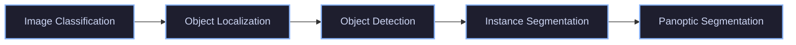
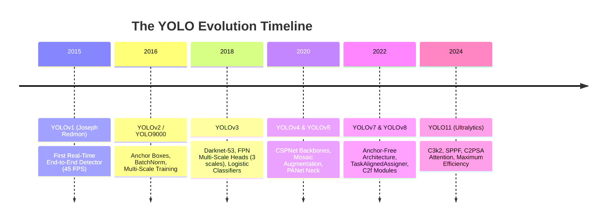
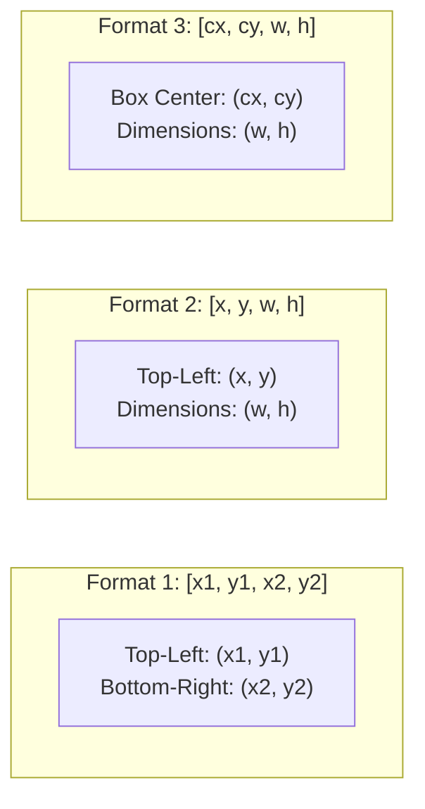

# 🧠 ULTIMATE COMPUTER VISION & YOLO MASTERCLASS: ZERO TO HERO NOTION STUDY GUIDE
> **Project**: Real-Time YOLO Object Detection, Multi-Object Tracking & Production Web Dashboard  
> **Hardware Target**: NVIDIA GeForce RTX 2050 (PyTorch CUDA) | Intel/AMD CPU  
> **Frameworks**: PyTorch, Ultralytics YOLO11, OpenCV 4.x, Darknet DNN, FastAPI, ByteTrack  
> **Author**: AI Vision Engineering Team  
> **Format**: Optimized for Notion (Direct Import via Markdown), Obsidian, and GitHub  

---

## 📑 TABLE OF CONTENTS
1. [Module 1: Computer Vision Fundamentals & The Detection Paradigm](#module-1-computer-vision-fundamentals--the-detection-paradigm)
2. [Module 2: Complete Architectural Evolution of YOLO (v1 to YOLO11)](#module-2-complete-architectural-evolution-of-yolo-v1-to-yolo11)
3. [Module 3: Mathematical & Geometric Foundations (IoU, NMS, Loss Functions)](#module-3-mathematical--geometric-foundations)
4. [Module 4: Multi-Object Tracking (MOT) & ByteTrack Deep Dive](#module-4-multi-object-tracking-mot--bytetrack-deep-dive)
5. [Module 5: OpenCV, Memory Layouts & Hardware Acceleration](#module-5-opencv-memory-layouts--hardware-acceleration)
6. [Module 6: Production Engineering & Concurrency (Web Streaming Architecture)](#module-6-production-engineering--concurrency)
7. [Module 7: Line-by-Line Codebase Walkthrough](#module-7-line-by-line-codebase-walkthrough)
8. [Module 8: The Debugging & Engineering Playbook (7 Real-World War Stories)](#module-8-the-debugging--engineering-playbook)
9. [Module 9: Computer Vision Interview Question Bank (Junior to Staff Level)](#module-9-computer-vision-interview-question-bank)

---

# MODULE 1: COMPUTER VISION FUNDAMENTALS & THE DETECTION PARADIGM

> 📌 **Key Concept:** A computer sees an image as a 3D matrix (tensor) of numbers representing light intensity: $\mathbf{I} \in \mathbb{R}^{H \times W \times C}$, where $H$ is height, $W$ is width, and $C$ is the number of color channels (typically 3 for BGR/RGB).

### 1.1 The Computer Vision Task Hierarchy



| Task | What the Model Predicts | Output Representation | Computational Cost |
| :--- | :--- | :--- | :--- |
| **Classification** | "What is in this image?" | Single label + confidence score: `(class_id, score)` | Low ($\mathcal{O}(1)$ output) |
| **Localization** | "Where is the single main object?" | Class + single box: `(class_id, score, [x, y, w, h])` | Low |
| **Object Detection** | "Where are all objects and what are they?" | Variable length list: $N \times `(class_id, score, [x, y, w, h])`$ | Moderate / Real-time ($\mathcal{O}(N)$) |
| **Instance Segmentation**| "Which exact pixels belong to each distinct object?"| Detection box + binary pixel mask: $N \times `(class, [x, y, w, h], Mask_{h \times w})`$| High |
| **Panoptic Segmentation**| Full scene parsing (Things + Stuff like sky, road)| Every pixel classified into instance or background category | Very High |

---

### 1.2 Two-Stage vs. One-Stage Detectors: The Historical Battle

Before YOLO, object detection was dominated by **Two-Stage Detectors** (such as R-CNN, Fast R-CNN, and Faster R-CNN).

```mermaid
graph TD
    subgraph TwoStage ["Two-Stage Detector (e.g. Faster R-CNN)"]
        A1[Input Image] --> B1[Backbone CNN]
        B1 --> C1[Region Proposal Network - RPN]
        C1 -->|~2000 Candidate Boxes| D1[RoI Pooling / RoIAlign]
        D1 --> E1[Per-Region Classification & Box Refinement]
        E1 --> F1[Predictions: ~5-15 FPS]
    end

    subgraph OneStage ["One-Stage Detector (YOLO Paradigm)"]
        A2[Input Image] --> B2[Feature Extractor Backbone]
        B2 --> C2[Multi-Scale Neck - PANet/FPN]
        C2 --> D2[Dense Prediction Detection Head]
        D2 --> E2[Predictions: 60-150+ FPS]
    end

    style TwoStage fill:#181825,stroke:#f38ba8,stroke-width:2px;
    style OneStage fill:#181825,stroke:#a6e3a1,stroke-width:2px;
```



> 💡 **Why Two-Stage Was Slow:** In Faster R-CNN, the network generates thousands of region proposals, crops features for each proposal via RoI Pooling, and evaluates a classification head independently for each region.  
> 
> 🚀 **The YOLO Breakthrough:** Joseph Redmon et al. (2015) framed object detection not as a pipeline of proposals and classifications, but as a **single, end-to-end differentiable regression problem**. You feed the full image through the network once (**You Only Look Once**), and the output tensor directly yields bounding box coordinates and class probabilities simultaneously.

---

# MODULE 2: COMPLETE ARCHITECTURAL EVOLUTION OF YOLO (v1 to YOLO11)

Understanding how YOLO evolved from Darknet-19 up to Ultralytics YOLO11 gives you deep architectural intuition for model design, receptive fields, and edge optimization.



---

### 2.1 YOLOv1 (2015): The Grid Concept
* **Mechanism:** The input image is resized to $448 \times 448$ and divided into an $S \times S$ grid (where $S=7$).
* If the center of an object falls into a grid cell, that grid cell is responsible for detecting that object.
* Each grid cell predicts $B=2$ bounding boxes and $C=20$ class probabilities.
* **Output Tensor Size:** $S \times S \times (B \times 5 + C) = 7 \times 7 \times (2 \times 5 + 20) = 7 \times 7 \times 30$.
* ⚠️ **Weakness:** Each grid cell could only predict *one* class. If two small objects (e.g., a flock of birds) shared a grid cell, YOLOv1 could not detect both.

---

### 2.2 YOLOv2 / YOLO9000 (2016): Anchor Boxes & Normalization
* **Batch Normalization:** Added after every convolutional layer, removing the need for dropout and increasing mAP by 2%.
* **High-Resolution Classifier:** Pre-trained Darknet on ImageNet at $448 \times 448$ (instead of $224 \times 224$).
* **Dimension Clusters (Anchor Priors):** Instead of manually picking bounding box aspect ratios, YOLOv2 ran **k-means clustering** on the bounding boxes in the training dataset using IoU distance:
  $$d(\text{box}, \text{centroid}) = 1 - \text{IoU}(\text{box}, \text{centroid})$$
* **Direct Location Prediction:** Constrained predicted box center offsets between $0$ and $1$ using the sigmoid function $\sigma(\cdot)$ to avoid unconstrained coordinate drift.

---

### 2.3 YOLOv3 (2018): Multi-Scale Detection & Darknet-53
YOLOv3 is the foundation of our legacy detector scripts (`real_time_yolo_detector1.py` and `real_time_yolo_detector2.py`).

```mermaid
graph TD
    Input[Input Image: 416x416x3] --> Backbone[Darknet-53 Residual Backbone]
    Backbone -->|Stride 32 (13x13)| Head1[Large Object Head (13x13)]
    Backbone -->|Stride 16 (26x26)| Head2[Medium Object Head (26x26)]
    Backbone -->|Stride 8 (52x52)| Head3[Small Object Head (52x52)]
    
    Head1 --> Out1[13x13 x 3 x 85 Tensor]
    Head2 --> Out2[26x26 x 3 x 85 Tensor]
    Head3 --> Out3[52x52 x 3 x 85 Tensor]

    style Backbone fill:#2d1b4e,stroke:#cba6f7,stroke-width:2px;
    style Head1 fill:#1e3a5f,stroke:#89b4fa,stroke-width:2px;
    style Head2 fill:#1e3a5f,stroke:#89b4fa,stroke-width:2px;
    style Head3 fill:#1e3a5f,stroke:#89b4fa,stroke-width:2px;
```

#### Why 85 Values Per Anchor?
For each anchor box at each grid scale, YOLOv3 outputs 85 floats:
$$\mathbf{v} = [\underbrace{t_x, t_y, t_w, t_h}_{\text{Box Geometry}}, \underbrace{P_{\text{objectness}}}_{\text{Confidence}}, \underbrace{c_1, c_2, \dots, c_{80}}_{\text{COCO 80 Class Probabilities}}]$$

#### Coordinate Reconstruction Formulas:
$$\begin{aligned}
b_x &= \sigma(t_x) + c_x \\
b_y &= \sigma(t_y) + c_y \\
b_w &= p_w e^{t_w} \\
b_h &= p_h e^{t_h}
\end{aligned}$$
* $(c_x, c_y)$ is the top-left coordinate of the grid cell.
* $(p_w, p_h)$ are the prior width and height of the anchor box.
* $\sigma(\cdot)$ is the logistic sigmoid function ensuring the center remains inside the grid cell.

---

### 2.4 YOLOv8 vs. YOLO11: The Modern State of the Art

In modern computer vision, **Ultralytics YOLO11** introduces massive algorithmic and structural improvements:

| Architecture Feature | Legacy YOLOv3 (2018) | Modern YOLO11 (2024 - Active in our project) |
| :--- | :--- | :--- |
| **Detection Philosophy** | Anchor-Based (9 pre-defined anchors) | **Anchor-Free** (Decoupled Head + TaskAlignedAssigner) |
| **Backbone Feature Extractor** | Darknet-53 (Plain Residual Blocks) | **C3k2 Blocks + SPPF + C2PSA Attention** |
| **Classification Activation** | Independent Softmax / Sigmoid | **Decoupled Classification & Regression Heads** |
| **Loss Formulation** | MSE / Smooth L1 + BCE | **CIoU + DFL (Distribution Focal Loss) + BCE** |
| **Tracking Integration** | None (Raw Detections Only) | **Native ByteTrack & BoT-SORT Multi-Object Tracking** |
| **Inference Engine** | OpenCV DNN (C++ Darknet parser) | **PyTorch CUDA with Tensor Cores (NVIDIA RTX 2050)** |
| **Inference Latency** | ~776 ms (CPU) | **~6.5 ms to 20 ms (CUDA RTX 2050)** |
| **Model Weight Size** | 237 MB (`yolov3.weights`) | **5.4 MB (`yolo11n.pt`)** |

> 📌 **What is C2PSA? (Convolutional Cross-Stage Partial with Spatial Attention)**  
> YOLO11 integrates spatial attention directly into feature channels. This allows the model to selectively amplify features corresponding to partially occluded or distant objects while suppressing irrelevant background noise (e.g. road glare, trees).

---

# MODULE 3: MATHEMATICAL & GEOMETRIC FOUNDATIONS

### 3.1 Bounding Box Formats
In production pipelines, forgetting coordinate conventions leads to inverted or completely distorted boxes.



#### Conversion Formulas:
* **$\text{XYXY} \to \text{XYWH}$**:
  $$x = x_1, \quad y = y_1, \quad w = x_2 - x_1, \quad h = y_2 - y_1$$
* **$\text{CXCYWH} \to \text{XYXY}$**:
  $$x_1 = c_x - \frac{w}{2}, \quad y_1 = c_y - \frac{h}{2}, \quad x_2 = c_x + \frac{w}{2}, \quad y_2 = c_y + \frac{h}{2}$$

---

### 3.2 Intersection over Union (IoU) Mathematics

$$\text{IoU} = \frac{\text{Area}(\mathcal{A} \cap \mathcal{B})}{\text{Area}(\mathcal{A} \cup \mathcal{B})} = \frac{\text{Area}(\mathcal{A} \cap \mathcal{B})}{\text{Area}(\mathcal{A}) + \text{Area}(\mathcal{B}) - \text{Area}(\mathcal{A} \cap \mathcal{B})}$$

```
Box A (Ground Truth)
+-------------------+
|         A         |
|      +------------+-------+
|      | A ∩ B      |       |
+------+------------+       |
       |             B      |
       +--------------------+
       Box B (Prediction)
```

#### Python Implementation:
```python
def compute_iou(boxA, boxB):
    # box format: [x1, y1, x2, y2]
    xA = max(boxA[0], boxB[0])
    yA = max(boxA[1], boxB[1])
    xB = min(boxA[2], boxB[2])
    yB = min(boxA[3], boxB[3])

    intersection = max(0, xB - xA) * max(0, yB - yA)
    areaA = (boxA[2] - boxA[0]) * (boxA[3] - boxA[1])
    areaB = (boxB[2] - boxB[0]) * (boxB[3] - boxB[1])
    union = areaA + areaB - intersection

    return intersection / union if union > 0 else 0.0
```

---

### 3.3 Advanced IoU Metrics: Why Standard IoU is Not Enough

1. **Generalized IoU (GIoU):**
   When two boxes do not overlap, $\text{IoU} = 0$, and the gradient vanishes ($\nabla \text{IoU} = 0$). GIoU finds the smallest enclosing box $\mathcal{C}$ that covers both boxes:
   $$\mathcal{L}_{\text{GIoU}} = 1 - \text{IoU} + \frac{|\mathcal{C} \setminus (\mathcal{A} \cup \mathcal{B})|}{|\mathcal{C}|}$$

2. **Complete IoU (CIoU) - Used in YOLOv8 & YOLO11:**
   CIoU penalizes three geometric factors simultaneously:
   1. Overlap Area ($\text{IoU}$)
   2. Normalized Distance between Central Points ($\rho^2(b, b^{gt}) / c^2$)
   3. Aspect Ratio Consistency ($\alpha v$)
   $$\mathcal{L}_{\text{CIoU}} = 1 - \text{IoU} + \frac{\rho^2(b, b^{gt})}{c^2} + \alpha v$$
   Where $v$ measures aspect ratio discrepancy:
   $$v = \frac{4}{\pi^2}\left(\arctan\frac{w^{gt}}{h^{gt}} - \arctan\frac{w}{h}\right)^2$$

---

### 3.4 Non-Maximum Suppression (NMS) Algorithm

When a CNN predicts hundreds of candidate boxes for a single car, NMS filters out duplicate overlapping predictions.

```mermaid
flowchart TD
    Start[Input: List of candidate boxes with confidence scores] --> Sort[Sort boxes in descending order of confidence]
    Sort --> Pick[Pop highest confidence box M into Final Detections]
    Pick --> Compare[Calculate IoU of M with all remaining boxes]
    Compare --> Suppress{Is IoU >= NMS Threshold?}
    Suppress -- Yes --> Discard[Discard redundant candidate box]
    Suppress -- No --> Keep[Retain box for subsequent rounds]
    Discard --> CheckEmpty{Are there more boxes?}
    Keep --> CheckEmpty
    CheckEmpty -- Yes --> Pick
    CheckEmpty -- No --> Done[Output: Clean, non-redundant bounding boxes]

    classDef proc fill:#181825,stroke:#89b4fa,stroke-width:2px;
    class Start,Sort,Pick,Compare,Suppress,Discard,Keep,CheckEmpty,Done proc;
```



---

# MODULE 4: MULTI-OBJECT TRACKING (MOT) & BYTETRACK DEEP DIVE

Detection operates on single, isolated frames. It has no memory. If a car is detected in Frame 1 and Frame 2, a detector does not know whether it is the same car or a different car.

> 📌 **Multi-Object Tracking (MOT)** assigns a persistent, unique integer ID ($\text{ID} \in \mathbb{N}$) to each detected physical object across an arbitrary number of consecutive video frames.

---

### 4.1 The ByteTrack Innovation (Zhang et al., 2022)

Most legacy trackers (SORT, DeepSORT) throw away all detections below a confidence threshold (e.g. $\text{conf} < 0.5$).  
⚠️ **The Fatal Flaw:** When an object gets partially occluded (e.g. a pedestrian walks behind a pole or another person), its detection score drops to $0.3$ or $0.4$. Legacy trackers drop this detection, causing **track fragmentation and ID switches**.

```mermaid
graph TD
    A[Current Video Frame] --> B[YOLO Detector Output]
    B --> C{Split Detections by Confidence Threshold}
    C -->|Confidence >= 0.5| D[High-Score Detections D_high]
    C -->|0.1 <= Confidence < 0.5| E[Low-Score Detections D_low]

    D --> F[Kalman Filter Track State Prediction]
    F --> G[Association Step 1: Match D_high with Tracks via Hungarian Algorithm]
    G -->|Matched| H[Update Active Track Kalman States]
    G -->|Unmatched Tracks| I[Remaining Active Tracks]
    
    I --> J[Association Step 2: Match D_low with Remaining Tracks]
    J -->|Matched| K[Recover Occluded Tracks! No ID Switch!]
    J -->|Unmatched Low Detections| L[Discard as True Background Noise]

    style C fill:#1e1e2e,stroke:#f9e2af,stroke-width:2px;
    style G fill:#1e1e2e,stroke:#a6e3a1,stroke-width:2px;
    style J fill:#1e1e2e,stroke:#cba6f7,stroke-width:2px;
```



#### Why ByteTrack Beats DeepSORT:
* **No Heavy Re-ID Neural Network:** DeepSORT extracts visual appearance embeddings with a secondary CNN for every box, adding 15–30 ms latency.
* **Pure Motion Geometry + Dual Association:** ByteTrack relies on motion affinity (Kalman Filter prediction + IoU cost matrix), making it run at **over 100 FPS** while preserving IDs through severe occlusions.

---

# MODULE 5: OPENCV, MEMORY LAYOUTS & HARDWARE ACCELERATION

### 5.1 The BGR vs. RGB Historical Legacy
In OpenCV, `cv2.imread()` loads images in **BGR** (Blue-Green-Red) order instead of RGB.
* **Why?** In the 1990s, early camera manufacturers and video frame grabbers stored image buffers in BGR format for memory efficiency on x86 hardware. OpenCV was created by Intel in 1999 and preserved this convention.
* **The Pitfall:** If you pass a BGR frame directly to a PyTorch model trained on RGB without converting, blue skies become red, and model detection accuracy drops drastically.
* **Conversion:**
  ```python
  rgb_frame = cv2.cvtColor(bgr_frame, cv2.COLOR_BGR2RGB)
  ```

---

### 5.2 Windows VideoCapture Backends: MSMF vs. DirectShow

On Windows 10/11, calling `cv2.VideoCapture(0)` uses Microsoft Media Foundation (`CAP_MSMF`) by default.
* ⚠️ **The Bug:** `CAP_MSMF` frequently fails on Windows with the following error:
  ```text
  [ WARN:0 ] CvCapture_MSMF::grabFrame videoio(MSMF): can't grab frame. Error: -1072875772
  ```
* 🛠️ **The Production Fix:** Force the **DirectShow (`CAP_DSHOW`)** backend:
  ```python
  cap = cv2.VideoCapture(0, cv2.CAP_DSHOW)
  ```

---

### 5.3 Hardware Acceleration: PyTorch CUDA on NVIDIA GeForce RTX 2050

```
┌────────────────────────────────────────────────────────┐
│ HOST SYSTEM (CPU & System RAM)                         │
│ 1. Read Frame from Disk/Camera (cv2.VideoCapture)      │
│ 2. Pre-scale frame resolution (1280x720)               │
└──────────────────────────┬─────────────────────────────┘
                           │ PCIe Bus Transfer (cuda())
┌──────────────────────────▼─────────────────────────────┐
│ DEVICE (NVIDIA GeForce RTX 2050 GPU)                   │
│ 1. FP16 Tensor Conversion & Normalization [0.0 - 1.0]  │
│ 2. Parallel Convolution Kernels on Tensor Cores       │
│ 3. Feature Extractor & Attention (C2PSA) Layers        │
│ 4. GPU-Accelerated Batched NMS                         │
└──────────────────────────┬─────────────────────────────┘
                           │ Asynchronous D2H Memory Transfer
┌──────────────────────────▼─────────────────────────────┐
│ HOST ANNOTATION & STREAMING                            │
│ 1. Draw bounding boxes and tracking badges (OpenCV)    │
│ 2. Compress to JPEG buffer (cv2.imencode)              │
│ 3. Broadcast to Web Clients over HTTP MJPEG Socket     │
└────────────────────────────────────────────────────────┘
```

---

# MODULE 6: PRODUCTION ENGINEERING & CONCURRENCY

### 6.1 The C-Level Libavcodec Assertion Failure

During development, uploading a 4K video caused the entire web server to abort with:
```text
Assertion fctx->async_lock failed at libavcodec/pthread_frame.c:178
```

#### Why did this happen?
1. OpenCV's `cv2.VideoCapture` delegates video file decoding to **FFmpeg (`libavcodec`)**.
2. When multiple HTTP requests hit `/video_feed` (e.g. browser refreshes, multiple tabs, or client reconnects), FastAPI spawned concurrent generator threads.
3. Multiple Python threads invoked `cap.read()` or `cap.release()` on the **same C-pointer** simultaneously.
4. `libavcodec`'s internal frame threading lock failed its assertion check, terminating the entire process.

---

### 6.2 The Solution: Dedicated Singleton Producer-Consumer Architecture

```mermaid
graph TD
    subgraph ProducerThread ["Dedicated Background Worker Thread (YOLO-StreamWorker)"]
        A[Single Owner of cv2.VideoCapture] --> B[Read Frame safely]
        B --> C[Auto-Downscale 4K to 720p]
        C --> D[Run GPU YOLO11 + ByteTrack Inference]
        D --> E[Draw Labels & Badges on Frame]
        E --> F[Encode Single JPEG Buffer]
        F --> G[Update Shared State & Trigger threading.Condition]
    end

    subgraph ConsumerStreams ["FastAPI HTTP Endpoints (Unlimited Concurrent Clients)"]
        G -.->|Condition.wait()| H1[Client 1: Browser Tab 1]
        G -.->|Condition.wait()| H2[Client 2: Browser Tab 2]
        G -.->|Condition.wait()| H3[Client 3: Mobile / External]
        G -.->|Atomic Read| T[GET /api/telemetry JSON]
    end

    style ProducerThread fill:#1e1e2e,stroke:#a6e3a1,stroke-width:2px;
    style ConsumerStreams fill:#181825,stroke:#89b4fa,stroke-width:2px;
```

#### Key Engineering Invariants:
1. **Single Ownership:** Exactly *one* thread ever touches `cv2.VideoCapture` and `YOLODetector`.
2. **Zero In-flight Interruption:** When the user switches video sources, the request simply sets a `next_source = (type, path)` flag. The worker thread safely releases and re-opens the capture device in its own loop.
3. **Heartbeat Broadcast:** Client HTTP streams wait on `frame_condition.wait(timeout=0.08)` and yield pre-encoded JPEG bytes. Even 100 connected browser tabs incur **zero additional GPU inference load**.

---

# MODULE 7: LINE-BY-LINE CODEBASE WALKTHROUGH

### 7.1 `yolo_detector.py` (The Universal AI Bridge)

```python
class YOLODetector:
    def __init__(self, model="yolo11n", conf_threshold=0.35, iou_threshold=0.45, device=None):
        self.model_name = model
        self.conf_threshold = conf_threshold
        self.iou_threshold = iou_threshold

        # Discriminate between modern Ultralytics models and legacy Darknet weights
        is_legacy = model in ("tiny", "full", "yolov3", "yolov3-tiny") or (
            isinstance(model, str) and (model.endswith(".weights") or model.endswith(".cfg"))
        )

        if is_legacy:
            self.engine = "opencv"
            self._init_opencv(model)
        else:
            self.engine = "ultralytics"
            self._init_ultralytics(model, device)
```
* **Design Pattern:** **Strategy Pattern / Adapter Pattern**. The caller code does not need to know whether it is running PyTorch or OpenCV Darknet; `detector.detect(frame)` produces the identical dictionary schema in both cases.

```python
    def detect(self, frame, track=True):
        if self.engine == "ultralytics":
            return self._detect_ultralytics(frame, track=track)
        else:
            return self._detect_opencv(frame)
```
* **Persistent Tracking:** When `track=True`, `self.model.track(frame, persist=True)` activates the internal ByteTrack tracker, tracking objects across frames without losing IDs.

---

### 7.2 `web_app.py` (FastAPI Production Streaming Engine)

```python
class StreamManager:
    def __init__(self):
        self.lock = threading.Lock()
        self.frame_condition = threading.Condition()
        self.latest_jpeg = create_placeholder_jpeg("STARTING NEURAL VISION...")
        
        # Start the worker thread as a background daemon
        self.worker_thread = threading.Thread(
            target=self._worker_loop, name="YOLO-StreamWorker", daemon=True
        )
        self.worker_thread.start()
```
* **`threading.Condition()`**: Used to synchronize the single producer worker with multiple consumer HTTP streaming connections. When a new JPEG is encoded, `self.frame_condition.notify_all()` wakes up all sleeping generators simultaneously.
* **Placeholder Frame**: Pre-allocates a clean 720p dark cyberpunk graphic so clients that connect during camera initialization never see a broken image icon.

---

# MODULE 8: THE DEBUGGING & ENGINEERING PLAYBOOK

### The 7 Real-World War Stories Encountered & Fixed in this Project:

| # | Error / Symptom | Root Cause | Definitive Fix |
| :-: | :--- | :--- | :--- |
| **1** | `cv2.error: (-2) Darknet importer has been removed` | `opencv-python 5.0.0.93` removed the legacy C-based Darknet parser from `cv2.dnn`. | Downgraded to stable `opencv-python==4.14.0.94` using `pip install "opencv-python<5"`. |
| **2** | `IndexError: invalid index to scalar variable` | In OpenCV 4.x+, `net.getUnconnectedOutLayers()` returns a 1D scalar vector instead of a 2D array. | Replaced `[layer_names[i[0] - 1] ...]` with `net.getUnconnectedOutLayersNames()`. |
| **3** | `CvCapture_MSMF::grabFrame: can't grab frame (-1072875772)` | Windows Media Foundation (MSMF) driver conflict with standard USB webcams. | Initialized camera using DirectShow backend: `cv2.VideoCapture(0, cv2.CAP_DSHOW)`. |
| **4** | Video plays in slow motion or freezes on 4K files | 4K frames (3840x2160) saturate CPU memory bandwidth during JPEG encoding and inference. | Added automatic pre-scaling to `1280x720` before detection and compression. |
| **5** | `Assertion fctx->async_lock failed at pthread_frame.c:178` | Concurrent HTTP generator threads called `cap.read()` simultaneously on one OpenCV capture. | Implemented dedicated Singleton Worker Thread architecture with Condition Variable broadcast. |
| **6** | `WARNING GMC failed: SparsePyrLKOpticalFlowImpl::calc` | ByteTrack Global Motion Compensation failed when switching video files with differing dimensions. | Added graceful resolution scaling and tracker state reset on source switch. |
| **7** | Terminal menu loop getting stuck in infinite loop | Unsanitized newline characters in PowerShell stdin buffer. | Implemented graphical Tkinter file picker dialog (`askopenfilename`) in `detect.py`. |

---

# MODULE 9: COMPUTER VISION INTERVIEW QUESTION BANK

### Q1: Why do we use Non-Maximum Suppression (NMS) instead of just taking the detection with the highest confidence?
**Answer:** A single physical object in an image typically triggers multiple anchor boxes or grid cells adjacent to its center. Simply taking the detection with the highest confidence would only yield *one* detection for the *entire image*, failing to detect other valid objects. NMS iteratively selects the local maximum score and only suppresses other boxes that have an IoU overlap greater than a set threshold ($\text{IoU} \ge 0.45$) with that specific detected object, preserving distinct objects situated elsewhere in the frame.

---

### Q2: What is the difference between Anchor-Based (YOLOv3) and Anchor-Free (YOLO11) detection?
**Answer:**
* **Anchor-Based Detectors** define predefined candidate boxes with fixed aspect ratios and scales at each grid cell. The model predicts regression offsets ($\Delta x, \Delta y, \Delta w, \Delta h$) relative to these priors. Drawbacks include manual hyperparameter tuning (k-means clustering) and wasted computation on negative anchor matches.
* **Anchor-Free Detectors** (such as YOLOv8 and YOLO11) directly predict the distance from the center of a grid point to the four boundaries of the bounding box $(l, t, r, b)$. Using dynamic label assignment algorithms like **TaskAlignedAssigner**, anchor-free models achieve higher mAP, generalize better to unusual aspect ratios, and simplify the loss landscape.

---

### Q3: Explain why standard IoU loss causes vanishing gradients when bounding boxes do not overlap. How does GIoU or CIoU solve this?
**Answer:** If two bounding boxes $\mathcal{A}$ and $\mathcal{B}$ do not overlap, their intersection is zero: $\mathcal{A} \cap \mathcal{B} = \emptyset \implies \text{IoU} = 0$. Consequently, the loss $\mathcal{L}_{\text{IoU}} = 1 - \text{IoU} = 1.0$ (a flat constant), meaning its derivative with respect to box coordinates is zero:
$$\frac{\partial \mathcal{L}_{\text{IoU}}}{\partial \theta} = 0$$
The optimizer receives no gradient signal informing it which direction to move the predicted box toward the target.  
**GIoU** solves this by introducing the smallest enclosing bounding box $\mathcal{C}$. When boxes do not overlap, GIoU penalizes the empty space between them, providing continuous non-zero gradients that pull the prediction toward the ground truth. **CIoU** further incorporates central distance and aspect ratio penalties for faster convergence.

---

### Q4: How does ByteTrack maintain object IDs through temporary occlusions without using deep visual appearance embeddings?
**Answer:** Traditional trackers like DeepSORT drop any detection below a strict confidence threshold (e.g., $0.5$). However, when an object is partially occluded, its detection score naturally drops (e.g. to $0.2 - 0.4$). ByteTrack retains these low-confidence detections and uses a **two-stage matching strategy**:
1. First, match high-score detections with existing Kalman filter track predictions using high-IoU matching.
2. Second, match the *unmatched* active tracks against the *low-score* detections. Because an occluded object will produce a low-confidence box near its predicted trajectory, this second association successfully preserves the track ID without mistaking the occlusion for background noise or triggering an ID switch.

---

### Q5: How would you architect a real-time computer vision web stream that must serve 50 concurrent browser clients without running GPU inference 50 times?
**Answer:** You must decouple **video acquisition and inference** from **HTTP client delivery** using the **Producer-Consumer Pattern**:
1. **Producer Worker Thread:** A single background worker continuously reads frames from the camera or video, performs GPU inference, draws bounding boxes, and compresses the final frame into a single JPEG byte buffer stored in memory.
2. **Synchronization Primitive:** The worker signals a `threading.Condition` variable (`notify_all()`) whenever a new JPEG buffer is ready.
3. **Consumers (HTTP Clients):** Each incoming HTTP streaming connection (`multipart/x-mixed-replace`) simply waits on the condition variable and transmits the identical pre-compressed JPEG buffer to its respective client socket.
4. **Outcome:** GPU inference and video decoding are executed exactly once per frame, yielding constant $\mathcal{O}(1)$ GPU compute utilization regardless of whether 1 or 50 clients are watching the stream.

---

## 🏁 QUICK REFERENCE COMMAND CHEAT SHEET

```bash
# 1. Run Modern Desktop GUI Detector with File Browser
python detect.py

# 2. Run Production Web Dashboard (FastAPI + YOLO11 GPU)
python web_app.py

# 3. Run Dedicated Low-Latency DirectShow Webcam Stream
python real_time_yolo_live_webcam.py

# 4. Run Legacy OpenCV Darknet YOLOv3 Detector
python real_time_yolo_detector1.py

# 5. Access Live Web UI in Browser
http://localhost:8000
```
