# 🎓 Student & Lecturer Guide: Real-Time YOLO AI Object Detection & Dashboard
> **Goal of this Guide:** To give you a clear, crystal-understandable explanation of how our entire project works from start to finish—so you can confidently explain it to your lecturer, answer any viva questions, and demonstrate the code without getting lost in heavy academic jargon.

---

## 📌 TABLE OF CONTENTS
1. [The 60-Second "Elevator Pitch" for Your Lecturer](#1-the-60-second-elevator-pitch)
2. [The Big Picture: How All Components Work Together](#2-the-big-picture-how-all-components-work-together)
3. [The End-to-End Pipeline: The Journey of a Single Frame](#3-the-end-to-end-pipeline-the-journey-of-a-single-frame)
4. [File-by-File Breakdown: Who Does What?](#4-file-by-file-breakdown-who-does-what)
5. [The AI Brain: Why We Upgraded from YOLOv3 to YOLO11](#5-the-ai-brain-why-we-upgraded-from-yolov3-to-yolo11)
6. [The Full-Stack Web Dashboard: How Backend & Frontend Talk](#6-the-full-stack-web-dashboard)
7. [The 3 Big Engineering Challenges We Solved](#7-the-3-big-engineering-challenges-we-solved)
8. [Step-by-Step Presentation Script (What to Say During Demo)](#8-step-by-step-presentation-script)
9. [Lecturer Viva Q&A Cheat Sheet (Top 10 Questions)](#9-lecturer-viva-qa-cheat-sheet)

---

## 1. THE 60-SECOND ELEVATOR PITCH
*(Memorize this or keep it in mind when your lecturer asks: "Tell me about your project in simple words.")*

> *"Respected Sir/Ma'am, our project is a **High-Performance Real-Time Computer Vision System** that detects, classifies, and tracks multiple objects in live video streams or webcam feeds.*
>
> *We took traditional object detection (which was slow and ran on legacy YOLOv3 at ~1-2 FPS on CPU) and modernised it into a full-stack, production-ready AI application:*
> 1. *On the **AI layer**, we implemented modern **YOLO11** accelerated by our **NVIDIA GeForce RTX 2050 GPU**, achieving real-time inference in just **6 to 20 milliseconds** (~50-100+ FPS), integrated with **ByteTrack** for persistent object ID tracking.*
> 2. *On the **Backend layer**, we built an asynchronous **FastAPI** server that manages video decoding and GPU inference using a **Singleton Worker Thread** architecture.*
> 3. *On the **Frontend layer**, we designed a responsive, glassmorphic **web dashboard** that receives a low-latency live video stream and real-time telemetry (FPS, latency, class counts) via HTTP APIs, complete with interactive controls for model switching and custom video uploads."*

---

## 2. THE BIG PICTURE: HOW ALL COMPONENTS WORK TOGETHER

Here is the high-level architecture diagram. You can draw this on a whiteboard for your lecturer:

```mermaid
graph TD
    subgraph Inputs ["1. Input Video Sources"]
        Cam["Webcam (cv2.CAP_DSHOW)"]
        Vid["Sample Video (uk.mp4 / usa.mp4)"]
        Up["Custom Upload (User Teaser/4K Video)"]
    end

    subgraph Backend ["2. Python Backend (web_app.py)"]
        Worker["Dedicated Stream Worker Thread"]
        OpenCV["OpenCV VideoCapture (Auto-Downscale 4K -> 720p)"]
        Detector["YOLODetector (yolo_detector.py)"]
        GPU["PyTorch CUDA on NVIDIA RTX 2050"]
        Tracker["ByteTrack Multi-Object Tracker"]
        FastAPI["FastAPI Server (Endpoints: /video_feed, /api/telemetry, /api/source)"]
    end

    subgraph Frontend ["3. Interactive Web Dashboard (static/)"]
        HTML["index.html (Dashboard Layout)"]
        CSS["styles.css (Glassmorphic Dark UI)"]
        JS["app.js (Telemetry Poller & Controls)"]
        StreamView["Live Video Viewport with Bounding Boxes"]
        TelemetryCards["Live Meters: FPS, Latency, Object Count"]
    end

    Cam --> OpenCV
    Vid --> OpenCV
    Up --> OpenCV
    OpenCV --> Worker
    Worker --> Detector
    Detector --> GPU
    GPU --> Tracker
    Tracker --> Worker
    Worker --> FastAPI
    FastAPI -->|MJPEG Stream /video_feed| StreamView
    FastAPI -->|JSON Stats /api/telemetry| TelemetryCards
    JS -->|Controls: Switch Source, Change Model| FastAPI

    style Backend fill:#1e1e2e,stroke:#89b4fa,stroke-width:2px;
    style Frontend fill:#181825,stroke:#a6e3a1,stroke-width:2px;
    style Inputs fill:#181825,stroke:#f9e2af,stroke-width:2px;
```



---

## 3. THE END-TO-END PIPELINE: THE JOURNEY OF A SINGLE FRAME

When you press "Run", what happens to every single frame? Explain this 5-step journey:

```
[Camera / Video File] 
       │ 
       ▼ (Step 1: Frame Grab)
  OpenCV captures raw BGR image matrix (e.g. 1920x1080)
       │
       ▼ (Step 2: Pre-Processing)
  Resize to standard size (e.g. 1280x720) so GPU doesn't get overloaded
       │
       ▼ (Step 3: Neural Network Brain)
  Fed into YOLO11 on NVIDIA RTX 2050 GPU (Inference time: ~6-15ms)
  ByteTrack assigns continuous IDs (Car #101, Person #102)
       │
       ▼ (Step 4: Annotation & Encoding)
  OpenCV draws colored bounding boxes, labels, and tracking badges
  Compressed into a lightweight JPEG buffer in RAM
       │
       ▼ (Step 5: Delivery to Browser)
  FastAPI pushes JPEG over MJPEG HTTP stream to  tag
  Telemetry endpoint sends JSON stats (FPS, Latency, counts) to JavaScript
```

---

## 4. FILE-BY-FILE BREAKDOWN: WHO DOES WHAT?

If your lecturer opens the project folder and asks: *"Explain what each file is doing and why you have multiple files,"* here is your clear answer:

| File Name | Role in Project | Plain English Explanation |
| :--- | :--- | :--- |
| **`yolo_detector.py`** | **The AI Engine** | This is the brain. It is an adapter class that can load *either* modern YOLO (YOLO11, YOLOv8 using PyTorch with GPU acceleration) *or* legacy YOLOv3 (using OpenCV DNN). It takes an image frame, finds all objects, runs ByteTrack to assign IDs, and draws bounding boxes. |
| **`web_app.py`** | **The Server & Streaming Hub** | Built with **FastAPI**. It runs a dedicated background worker thread that continuously reads frames, calls `yolo_detector.py`, and streams the processed frames to the web browser via the `/video_feed` endpoint. It also provides JSON API endpoints (`/api/telemetry`, `/api/source`, `/api/config`, `/api/upload`). |
| **`detect.py`** | **Desktop CLI & GUI Launcher** | A standalone desktop application for users who don't want a browser. It has a graphical file picker popup (using Tkinter), lets you choose webcam or video, and opens a desktop OpenCV window with keyboard shortcuts (`P` for pause, `S` for snapshot, `T` for tracking). |
| **`static/index.html`** | **Dashboard Structure** | The HTML template for the web dashboard. Defines the layout: top metrics bar (FPS, Latency, Object count), video viewport, source switching tabs, and AI control panel. |
| **`static/styles.css`** | **Dashboard Styling** | Vanilla CSS (no bloated dependencies like Tailwind). Implements a futuristic, cyber-dark glassmorphic theme designed to fit within a single screen (`100vh`) without ugly scrollbars. |
| **`static/app.js`** | **Dashboard Interactivity** | The client-side JavaScript. It polls `/api/telemetry` every 350ms to animate the FPS/latency meters and object lists. When the user clicks a button (e.g., switches source, moves confidence slider), it sends a POST request back to FastAPI. |
| **`real_time_yolo_live_webcam.py`** | **DirectShow Webcam Utility** | A lightweight, dedicated webcam script that uses Windows DirectShow (`cv2.CAP_DSHOW`) to guarantee smooth webcam detection without Windows Media Foundation driver errors. |
| **`real_time_yolo_detector1.py` / `2.py`** | **Legacy YOLOv3 Scripts** | The original legacy scripts using the 2018 Darknet weights (`yolov3.weights`). We kept and fixed these scripts so we can compare legacy CPU performance against our modern GPU YOLO11! |

---

## 5. THE AI BRAIN: WHY WE UPGRADED FROM YOLOV3 TO YOLO11

Your lecturer will likely ask: *"Why did you use YOLO11? What was wrong with YOLOv3?"*

### Real-World Analogy:
* **YOLOv3 (2018)** is like a heavy diesel truck: reliable in its time, but heavy (237 MB weights), slow (~1-2 FPS on CPU, ~770ms per frame), and uses outdated anchor-box mechanics.
* **YOLO11 (2024)** is like a modern electric sports car: tiny footprint (5.4 MB weights), hyper-efficient (~6-20ms latency on our RTX 2050 GPU, 50-100+ FPS), anchor-free, and natively supports tracking.

### Comparison Table to Show Your Lecturer:

| Feature | Legacy YOLOv3 (Old) | Modern YOLO11 (Our Upgrade) | Why It Matters |
| :--- | :--- | :--- | :--- |
| **Speed (Latency)** | ~776 ms per frame (1.3 FPS) | **~6.5 to 15 ms per frame (70+ FPS)** | 50x faster! Enables true real-time video without lag. |
| **Hardware** | Ran on CPU via OpenCV DNN | **Ran on NVIDIA RTX 2050 CUDA GPU** | Harnesses GPU Tensor Cores for parallel tensor math. |
| **Model Size** | 237 MB (`yolov3.weights`) | **5.4 MB (`yolo11n.pt`)** | 44x smaller! Loads instantly and fits edge devices. |
| **Detection Method** | Anchor-based (pre-set box shapes) | **Anchor-free (TaskAlignedAssigner)** | Adapts much better to unusual shapes and angles. |
| **Object Tracking** | None (Raw detections only) | **Integrated ByteTrack** | Objects don't just get detected; they get permanent IDs (`Car #101`). |

---

## 6. THE FULL-STACK WEB DASHBOARD

Your lecturer will ask: *"How did you connect the Python AI code to the web page?"*

Here is the exact explanation in 2 parts:

### Part A: How the Video Streams (`/video_feed`)
1. The web page has a normal `` tag:
   ```html
   
   ```
2. In `web_app.py`, the endpoint `/video_feed` returns a **StreamingResponse** with content type `multipart/x-mixed-replace; boundary=frame`.
3. Instead of sending an MP4 video file, the server continuously pumps individual JPEG pictures one after another over the same open HTTP connection:
   ```
   --frame
   Content-Type: image/jpeg
   [binary JPEG bytes of Frame 1]
   --frame
   Content-Type: image/jpeg
   [binary JPEG bytes of Frame 2]
   ...
   ```
4. The browser automatically renders each new JPEG as it arrives, creating a buttery-smooth video feed without needing WebRTC or complex streaming servers!

### Part B: How the Telemetry & Controls Work (`/api/telemetry` & `/api/config`)
1. In `app.js`, a JavaScript timer runs every 350 milliseconds:
   ```javascript
   setInterval(fetchTelemetry, 350);
   ```
2. It calls `GET /api/telemetry`. The Python backend returns a small JSON package:
   ```json
   {
     "fps": 24.5,
     "latency_ms": 14.2,
     "active_model": "yolo11n",
     "object_count": 4,
     "class_counts": { "car": 3, "person": 1 }
   }
   ```
3. JavaScript reads this data and updates the live text meters, progress bars, and detected objects list dynamically on the screen.
4. When you drag a slider (like Confidence) or pick a new model, JavaScript sends a `POST /api/config` with the new values, and Python updates the detector instantly on the fly.

---

## 7. THE 3 BIG ENGINEERING CHALLENGES WE SOLVED

Lecturers love hearing about **real problems you faced and how you solved them**. Here are the three best stories to tell:

### 1. The Windows Webcam Crash (`MSMF` vs `DirectShow`)
* **Problem:** On Windows 10/11, calling default `cv2.VideoCapture(0)` crashed with error `-1072875772` because Windows Media Foundation (`MSMF`) failed to negotiate frame grabs with the webcam driver.
* **Our Fix:** We explicitly specified the **DirectShow (`cv2.CAP_DSHOW`)** video backend in OpenCV:
  ```python
  cap = cv2.VideoCapture(0, cv2.CAP_DSHOW)
  ```
  This bypassed the buggy Windows Media Foundation layer and restored smooth, instant webcam access.

### 2. The 4K Video Server Crash (`Assertion fctx->async_lock failed`)
* **Problem:** When we tested a high-resolution 4K video (`Adobe Express - Gruhapravesha Teaser.mp4`), the server suddenly crashed with an assertion failure in FFmpeg (`libavcodec`).
* **Why it happened:** In our first version, every browser request ran its own loop calling `cap.read()`. Having multiple threads reading from the same video decoder at the same time caused a C-level race condition!
* **Our Fix (The Singleton Worker Thread):**
  We refactored `web_app.py` into a **Producer-Consumer Pattern**:
  * Exactly **one background worker thread** owns the video file, reads frames, and downscales 4K frames to 720p.
  * Browser clients never touch OpenCV directly—they simply read the latest pre-encoded JPEG broadcasted by the worker thread.
  * Result: Zero crashes, zero race conditions, and multiple browser tabs can watch the stream at the same time without any extra GPU load!

### 3. The OpenCV 5.0 Darknet Removal Bug
* **Problem:** In our environment with Python 3.12, pip originally installed `opencv-python 5.0`, which had completely removed the Darknet parser (`cv2.dnn.readNet`), breaking the legacy YOLOv3 code.
* **Our Fix:** We investigated the OpenCV release notes and pinned the library to `opencv-python==4.14.0.94`, ensuring backward compatibility for legacy Darknet while modern YOLO runs smoothly via PyTorch Ultralytics.

---

## 8. STEP-BY-STEP PRESENTATION SCRIPT
*(Use this as a guide when giving your live demo to your lecturer!)*

### Step 1: Introduction (30 seconds)
> *"Hello Sir/Ma'am. Today I am presenting our Real-Time YOLO Object Detection and Multi-Object Tracking Dashboard. In this project, we explored how modern deep learning models can perform low-latency object detection on live camera feeds and high-definition video, and how to serve these predictions through a responsive web architecture."*

### Step 2: Show the Web Dashboard (1 minute)
> *"Let me start by opening our dashboard at `localhost:8000`. As you can see on the screen:*
> - *At the top, we have our live telemetry bar showing our **real-time FPS**, **inference latency in milliseconds**, and total detected objects.*
> - *Notice the hardware badge shows **NVIDIA GeForce RTX 2050**—all neural network convolutions are running on our dedicated GPU.*
> - *In the center viewport, you can see bounding boxes around detected cars and pedestrians. Notice each object has a unique number—for example, `Car #96` or `Car #102`. That is our **ByteTrack tracking algorithm** keeping track of which car is which across frames.*
> - *On the right, we have a live class breakdown showing the distribution of objects in the frame."*

### Step 3: Demonstrate Live Interactivity (1 minute)
> *"Now let me demonstrate the interactive controls:*
> 1. *I can switch video sources seamlessly—clicking 'USA Street' switches the stream instantly.*
> 2. *I can adjust the **Confidence Threshold slider**—if I increase it to 70%, only high-confidence objects remain. If I lower it to 25%, fainter or partially occluded objects appear.*
> 3. *We can also upload any custom video or image directly using this drag-and-drop zone."*

### Step 4: Explain the Technical Highlights (1 minute)
> *"Under the hood, we made two major engineering contributions:*
> 1. *We upgraded from legacy **YOLOv3** (which took ~770ms per frame on CPU) to **YOLO11**, bringing latency down to just **10-15ms** per frame on GPU.*
> 2. *We designed a thread-safe **Producer-Consumer architecture** in FastAPI so the video capture and AI inference run in a dedicated background worker thread, ensuring the web interface remains 100% fluid and responsive without server crashes."*

---

## 9. LECTURER VIVA Q&A CHEAT SHEET
*(Top 10 questions your lecturer might ask, with the best simple answers!)*

#### Q1: What is YOLO, and how does it differ from traditional CNN classification?
> **Answer:** *"YOLO stands for 'You Only Look Once'. Traditional CNN classifiers can only tell you what an entire image is (e.g. 'this is a dog'). To find multiple objects, older methods had to propose thousands of regions and classify each one separately. YOLO treats detection as a single regression problem: it looks at the full image once and predicts bounding box coordinates and class probabilities simultaneously across the entire image in a single forward pass."*

#### Q2: What is the difference between Object Detection and Object Tracking?
> **Answer:** *"Detection operates on a single frame in isolation—it finds objects in Frame 1, and finds objects in Frame 2, but has no memory. Tracking connects detections across consecutive frames over time, assigning a persistent ID (like `Person #5`) so we can measure speed, trajectory, and count unique visitors."*

#### Q3: Which tracking algorithm did you use, and why?
> **Answer:** *"We used **ByteTrack**. Unlike older trackers like DeepSORT that require a secondary heavy neural network to extract appearance features, ByteTrack uses motion estimation with a Kalman Filter and a two-stage matching technique. It matches high-confidence detections first, and then matches remaining tracks with low-confidence detections. This prevents ID switches during temporary occlusions while running at over 70+ FPS."*

#### Q4: Why did your web server crash on 4K video, and how did you fix it?
> **Answer:** *"The original code had each browser connection reading directly from the OpenCV VideoCapture object. OpenCV's FFmpeg C-decoder is not thread-safe, so multiple simultaneous reads caused an assertion failure (`async_lock failed`). We fixed it by implementing a **Singleton Worker Thread** in `web_app.py`. A single background thread reads and downscales the video, and the web clients simply read the latest broadcasted JPEG."*

#### Q5: What is Non-Maximum Suppression (NMS)?
> **Answer:** *"Because YOLO evaluates multiple neighboring grid points, it often predicts multiple overlapping bounding boxes for the exact same object. Non-Maximum Suppression (NMS) sorts all candidate boxes by confidence, takes the highest one, and discards all other overlapping boxes that have an Intersection-over-Union (IoU) greater than a threshold (typically 0.45), leaving only one clean box per object."*

#### Q6: Why did you downgrade OpenCV to version 4.14?
> **Answer:** *"OpenCV 5.0 completely deprecated and removed the legacy Darknet C-parser (`cv2.dnn.readNet`), which broke backwards compatibility for our legacy YOLOv3 models. Downgrading to OpenCV 4.14 preserved the Darknet importer while remaining fully compatible with modern PyTorch and Python 3.12."*

#### Q7: What is the role of FastAPI in this project?
> **Answer:** *"FastAPI acts as our high-performance asynchronous web backend. It serves our static dashboard assets, exposes REST endpoints for telemetry and system configuration, and manages the low-latency MJPEG video stream using `StreamingResponse`."*

#### Q8: How does the GPU acceleration work in your system?
> **Answer:** *"We utilize PyTorch with CUDA 12.1 targeting our **NVIDIA GeForce RTX 2050 GPU**. When OpenCV captures a frame in host RAM, it is converted into a PyTorch tensor, transferred to GPU memory via PCIe, and processed in parallel across CUDA cores and Tensor Cores in half-precision (FP16), reducing inference time from ~770ms on CPU to ~10ms on GPU."*

#### Q9: What is the purpose of `cv2.CAP_DSHOW` on Windows?
> **Answer:** *"On Windows, OpenCV defaults to Microsoft Media Foundation (`MSMF`), which frequently fails to grab frames from USB webcams due to driver incompatibility. `cv2.CAP_DSHOW` forces OpenCV to use DirectShow, which is the stable, low-level Windows video capture API."*

#### Q10: If you had more time, what future enhancements would you add?
> **Answer:** *"I would add three enhancements: (1) Zone-based intrusion detection and line-crossing counts (e.g. counting how many cars entered a lane), (2) Exporting detection analytics to a database like SQLite or TimescaleDB for historical reporting, and (3) Running INT8 quantization using NVIDIA TensorRT for an additional 2-3x inference speedup."*

---

## 🚀 QUICK COMMAND SUMMARY

To run any part of the project during your demo:

```bash
# 1. Run the Web Dashboard (Recommended for main presentation)
python web_app.py
# -> Open http://localhost:8000 in your browser

# 2. Run Desktop GUI (With file picker dialog)
python detect.py

# 3. Run Live Dedicated Webcam Detector
python real_time_yolo_live_webcam.py

# 4. Run Legacy YOLOv3 Detector (For comparison)
python real_time_yolo_detector1.py
```

