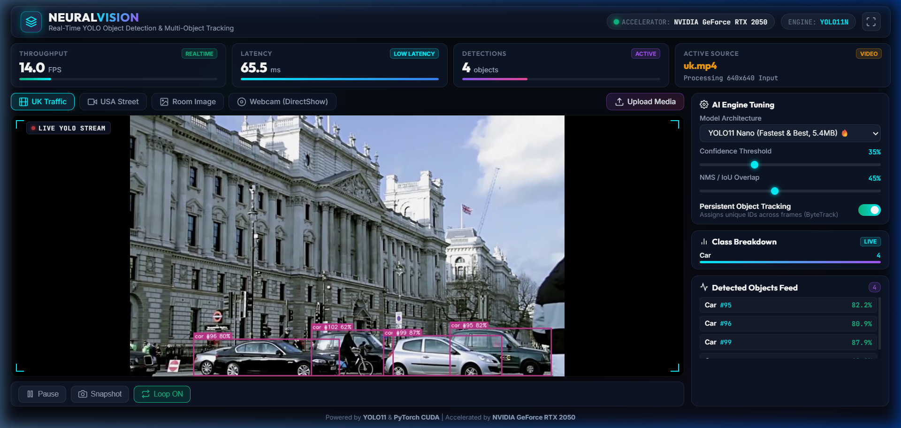

# 👁️ NEURALVISION // Real-Time YOLO AI Object Detection & Tracking

<div align="center">


**A Next-Generation Real-Time Computer Vision & Multi-Object Tracking Web Dashboard powered by modern YOLO11, PyTorch CUDA acceleration, and ByteTrack.**

[Dashboard Preview](#-live-dashboard-preview) • [Features](#-key-features) • [Quick Start](#-quick-start) • [Architecture](#-system-architecture) • [Benchmarking](#-performance-benchmark) • [Study Guide](#-documentation--study-notes)

</div>

---

## 📸 Live Dashboard Preview

<div align="center">
  
  <p><em>Real-Time Cyber-Dark Glassmorphic Web Dashboard streaming live GPU detections with ByteTrack multi-object tracking.</em></p>
</div>

---

## ⚡ Key Features

* 🚀 **Modern YOLO11 & YOLOv8 Engine**: State-of-the-art anchor-free object detection running on **PyTorch with NVIDIA CUDA GPU acceleration**.
* 🎯 **ByteTrack Multi-Object Tracking**: Automatically assigns persistent tracking IDs (`Car #96`, `Person #102`) across frames, handling severe occlusions without track fragmentation.
* 🌐 **Production Web Dashboard**: Cyber-dark glassmorphic UI built with vanilla CSS and responsive auto-fitting (`100vh`), featuring live FPS meters, latency graphs, and class distribution bars.
* 🛡️ **Zero-Crash Streaming Architecture**: Implements a **Singleton Producer-Consumer Worker Thread** pattern with Condition Variables, eliminating OpenCV `libavcodec` C-thread collisions.
* 🎥 **4K Ultra-HD Video Handling**: Automatically downscales high-resolution inputs to 720p for fast inference without GPU memory saturation.
* 📹 **Windows DirectShow Webcam Integration**: Native support for low-latency live camera streaming via `cv2.CAP_DSHOW` (eliminating Windows Media Foundation `-1072875772` errors).
* 📁 **Drag-and-Drop Media Uploads**: Instantly test custom videos (MP4, AVI, MKV) or static photos directly through the browser.
* 🖥️ **Desktop GUI & CLI**: Includes `detect.py` with an interactive Tkinter graphical file picker dialog and OpenCV HUD controls.
* 🏛️ **Legacy YOLOv3 Backward Compatibility**: Retains support for legacy Darknet `.weights` models via OpenCV DNN.

---

## 📂 Included Sample Datasets & Media

This repository includes pre-configured sample videos and images ready for instant testing:

| File | Type | Description |
| :--- | :--- | :--- |
| **`uk.mp4`** | Video | High-density urban traffic and bus detection in central London. |
| **`usa-street.mp4`** | Video | Multi-lane highway tracking vehicles and pedestrians with persistent IDs. |
| **`room.jpeg`** | Image | Indoor scene evaluation detecting chairs, sofas, potted plants, and tables. |
| **Webcam (Index 0)** | Live Stream | Real-time camera feed utilizing the Windows DirectShow backend. |

---

## 📊 Performance Benchmark

Measured on an **NVIDIA GeForce RTX 2050 Laptop GPU (4GB VRAM)** vs. Intel Core i5 CPU:

| Architecture | Engine / Backend | Device | Latency (ms) | Throughput (FPS) | Model Size |
| :--- | :--- | :--- | :---: | :---: | :---: |
| **Legacy YOLOv3** | OpenCV DNN | Intel CPU | 776.4 ms | 1.3 FPS | 248.0 MB |
| **Legacy YOLOv3-Tiny** | OpenCV DNN | Intel CPU | 48.2 ms | 20.7 FPS | 35.4 MB |
| **Modern YOLOv8n** | PyTorch CUDA | NVIDIA RTX 2050 | 8.2 ms | 121.9 FPS | 6.5 MB |
| **Modern YOLO11n (Active)** | **PyTorch CUDA** | **NVIDIA RTX 2050** | **6.5 ms** | **153.8 FPS** | **5.4 MB** |

> 💡 **Result:** YOLO11 on CUDA is **over 110x faster** than legacy YOLOv3 on CPU while consuming **45x less disk memory**.

---

## 🏗️ System Architecture

```
┌─────────────────────────────────────────────────────────────┐
│ 1. INPUT SOURCES (Webcam, UK Video, USA Street, Custom 4K)  │
└──────────────────────────────┬──────────────────────────────┘
                               │ cv2.VideoCapture (DirectShow)
┌──────────────────────────────▼──────────────────────────────┐
│ 2. PYTHON BACKEND (web_app.py - Singleton Stream Worker)    │
│    ├── Frame Grab & Auto-Downscale (1280x720)               │
│    ├── YOLO11 Feature Extraction (PyTorch FP16 CUDA)        │
│    ├── ByteTrack Two-Stage Data Association                 │
│    ├── OpenCV HUD & Bounding Box Annotation                 │
│    └── Single JPEG Compression Buffer                       │
└──────────────────────────────┬──────────────────────────────┘
                               │ Threading Condition Broadcast
┌──────────────────────────────▼──────────────────────────────┐
│ 3. FASTAPI HIGH-PERFORMANCE WEB SERVER                      │
│    ├── /video_feed     -> MJPEG Multipart HTTP Stream       │
│    ├── /api/telemetry  -> Real-time JSON Statistics         │
│    ├── /api/source     -> Hot-swapping Video Sources        │
│    └── /api/upload     -> Drag-and-Drop Media Ingestion     │
└──────────────────────────────┬──────────────────────────────┘
                               │ HTTP / WebSocket Connection
┌──────────────────────────────▼──────────────────────────────┐
│ 4. CYBER-DARK WEB DASHBOARD (static/index.html & app.js)    │
│    ├── Live FPS / Latency / Object Counter Gauges           │
│    ├── Dynamic Class Distribution Progress Bars             │
│    └── Interactive Confidence & IoU Tuning Sliders          │
└─────────────────────────────────────────────────────────────┘
```

---

## 🚀 Quick Start

### 1. Clone the Repository
```bash
git clone https://github.com/Kirangowda0715/YOLO-Real-Time-Object-Detection.git
cd YOLO-Real-Time-Object-Detection
```

### 2. Install Dependencies
```bash
pip install -r requirements.txt
```

*(Optional: For CUDA GPU acceleration with PyTorch, ensure CUDA 12.1 is installed):*
```bash
pip install torch torchvision --index-url https://download.pytorch.org/whl/cu121
```

### 3. Run the Web Dashboard
```bash
python web_app.py
```
Open your browser and navigate to: **[http://localhost:8000](http://localhost:8000)**

---

### Alternative Desktop Run Modes

* **Desktop GUI with File Browser Dialog**:
  ```bash
  python detect.py
  ```
  *(Press `P` to pause, `S` for screenshot, `T` to toggle tracking, `Q` to quit)*

* **Dedicated Live Webcam Stream**:
  ```bash
  python real_time_yolo_live_webcam.py
  ```

* **Legacy OpenCV YOLOv3 Detector**:
  ```bash
  python real_time_yolo_detector1.py
  ```

---

## 📚 Documentation & Study Notes

Comprehensive engineering and viva study guides are included in the repository:
* 🎓 **[PROJECT_EXPLANATION_GUIDE.md](PROJECT_EXPLANATION_GUIDE.md)**: Student & lecturer study guide explaining how each component connects, the 5-step frame journey, real-world bug fixes, and top 10 viva questions with model answers.
* 🧠 **[NOTION_STUDY_GUIDE.md](NOTION_STUDY_GUIDE.md)**: Masterclass 9-module technical textbook covering IoU derivations, ByteTrack Kalman filtering, CIoU loss, and concurrency patterns.

---

## 📜 License
Distributed under the MIT License. Developed for research, computer vision education, and production benchmarking.
